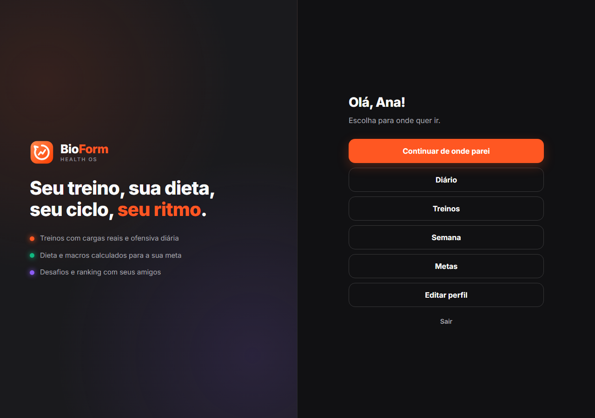
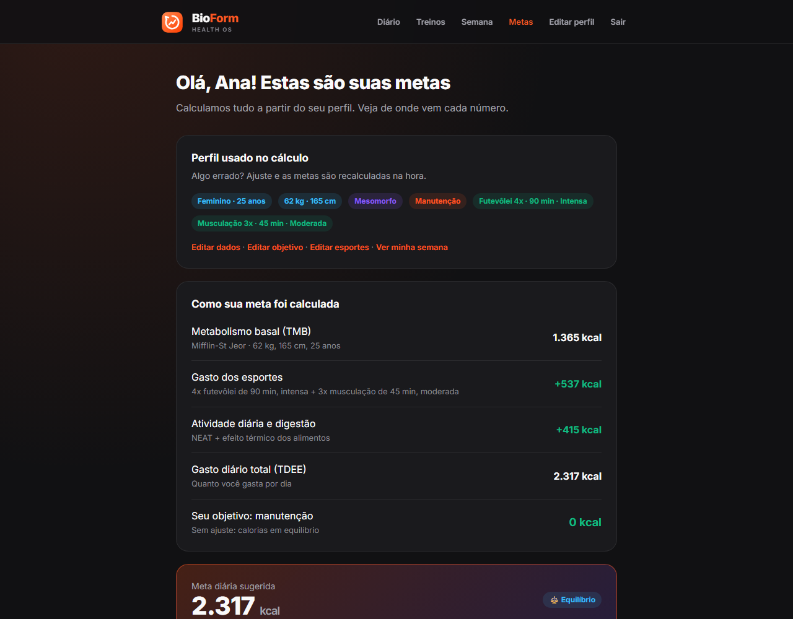
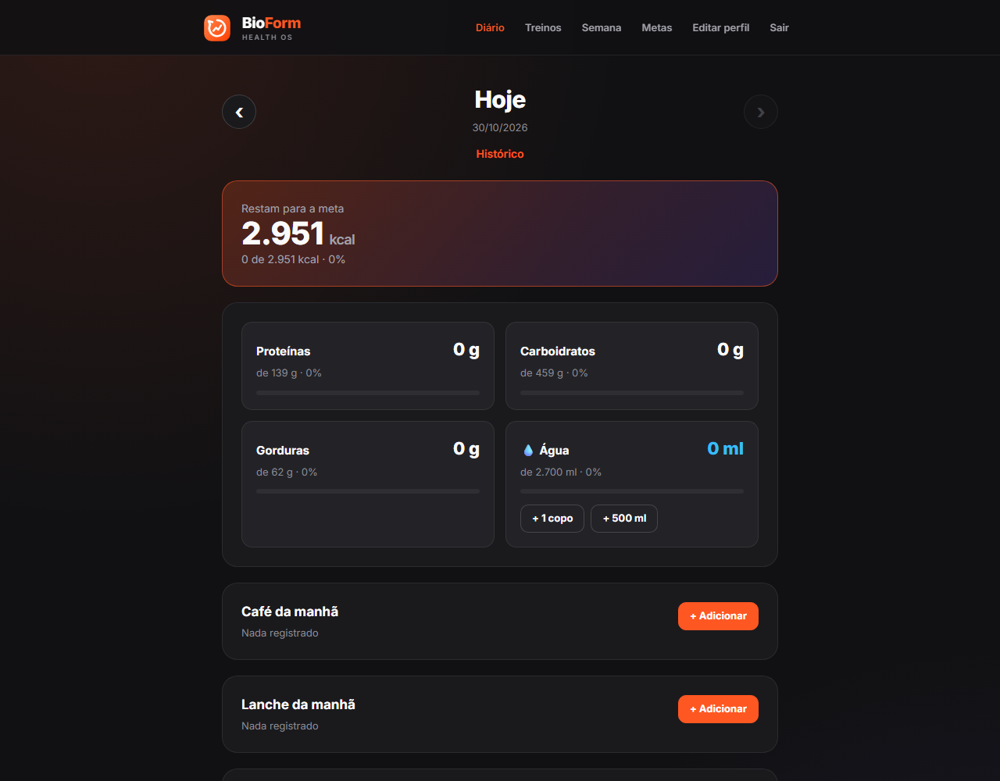
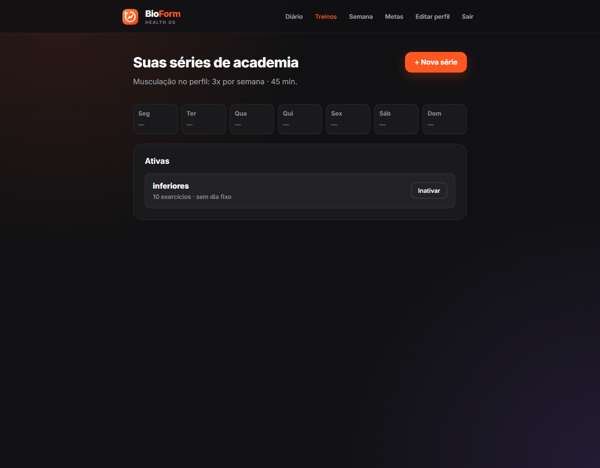
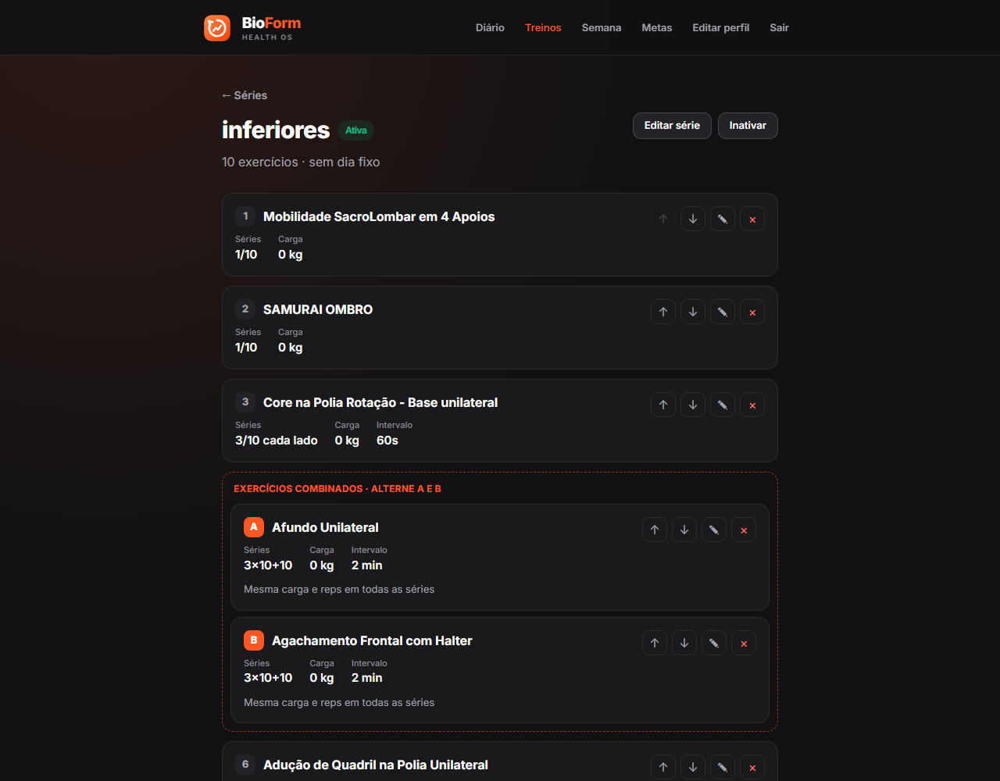
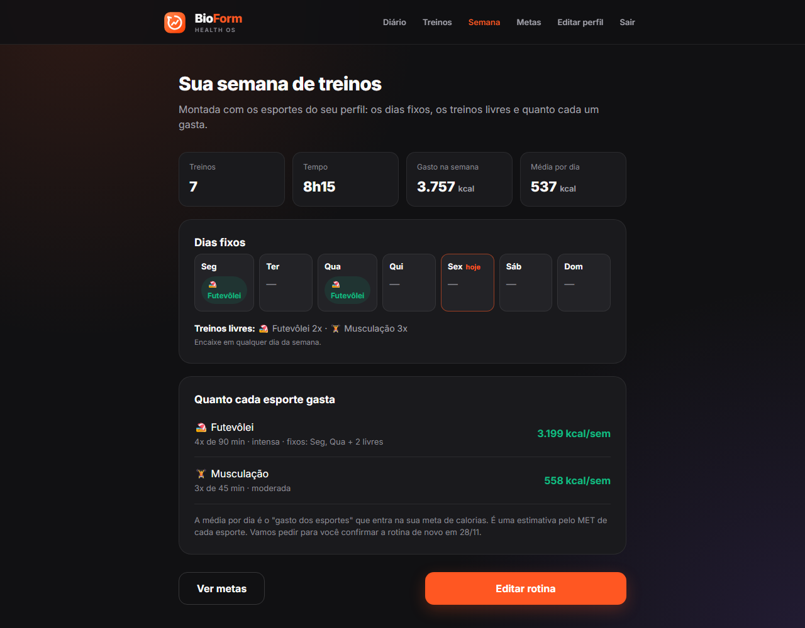

# BioForm Health OS

Projeto Integrado de Software (ENG4021 · PUC-Rio) do **Grupo 5**.

## Componentes do grupo

| Integrante | GitHub |
|---|---|
| Gustavo Yin | [@GustavoYin](https://github.com/GustavoYin) |
| Leonardo Bruzzone | [@leonardobruzzone16](https://github.com/leonardobruzzone16) |
| Lucas Pinho | [@lucasgpinho0310](https://github.com/lucasgpinho0310) |
| Pedro | [@pedrobapedro01-max](https://github.com/pedrobapedro01-max) |

## Tema

O BioForm é um site de saúde para quem pratica esporte e quer acompanhar treino e alimentação no mesmo lugar.
A pessoa cria a conta, informa os dados do corpo, o objetivo (perder, manter ou ganhar peso) e os esportes que pratica.
A partir disso o site:

- calcula a meta diária de calorias, proteínas, carboidratos, gorduras e água, mostrando de onde vem cada número;
- registra no **diário** o que foi comido em cada refeição e a água do dia, comparando com a meta;
- guarda as **séries de academia** (fichas de treino com exercícios, séries, cargas e intervalos);
- monta a **semana de treinos** com os dias fixos de cada esporte e quanto cada um gasta.

## Como colocar o site no ar

### No GitHub Codespaces

1. No repositório, clique em **Code → Codespaces → Create codespace on main**.
2. Ao abrir, o Codespace instala o Django, cria o banco de dados e liga o servidor na porta 8000 sozinho
   (configuração em [`.devcontainer/devcontainer.json`](.devcontainer/devcontainer.json)).
3. Abra a aba **Ports** e clique no link da porta 8000.

Para ligar o servidor manualmente (por exemplo, depois de um `git pull`):

```bash
cd "BioForm/Banco de Dados"
pip install -r requirements.txt
python manage.py migrate
python manage.py runserver 0.0.0.0:8000
```

Para criar o superusuário e entrar na interface administrativa (`/admin/` no final do link do site):

```bash
python manage.py createsuperuser
```

### No computador

```bash
cd "BioForm/Banco de Dados"
python -m venv venv
source venv/bin/activate        # Windows: venv\Scripts\activate
pip install -r requirements.txt
python manage.py migrate
python manage.py runserver
```

Site: http://127.0.0.1:8000/

## Como usar o site

### 1. Home-page

A home-page (`/`) leva para o login e para o cadastro. Depois de entrar, ela mostra os links para todas as páginas do site.




### 2. Entrar ou criar uma conta

Na página de login (`/accounts/login/`), entre com e-mail ou CPF e senha, ou clique em **Criar uma conta**.
Depois do cadastro, o site pede em quatro passos os dados do corpo, o objetivo e os esportes praticados.


As rotas de login, logout e senha seguem o padrão do Django (`django.contrib.auth.urls`):

| Rota | Página |
|---|---|
| `accounts/login/` | entrar |
| `accounts/logout/` | sair (método POST) |
| `accounts/password_change/` | trocar a senha |
| `accounts/password_reset/` | esqueci minha senha (o e-mail aparece no terminal do `runserver`) |
| `accounts/reset/<uidb64>/<token>/` | criar a nova senha pelo link do e-mail |

Os endereços antigos (`/entrar/`, `/sair/`, `/senha/esqueci/` e `/conta/senha/`) continuam funcionando.

### 3. Ver as metas

Em **Metas**, o site mostra a meta diária de calorias e explica a conta: metabolismo basal, gasto dos esportes,
atividade diária e o ajuste do objetivo. Logo abaixo estão as metas de proteínas, carboidratos, gorduras e água.



### 4. Registrar o que comeu no diário

Em **Diário**, cada refeição do dia tem o botão **+ Adicionar** para buscar alimentos da tabela TACO.
O topo mostra quanto falta para a meta, e os botões **+ 1 copo** e **+ 500 ml** registram a água.
As setas trocam de dia e **Histórico** mostra os dias anteriores.



### 5. Cadastrar as séries de academia

Em **Treinos**, crie uma série (ficha) e adicione os exercícios com séries, repetições, carga e intervalo.
Também dá para colar um treino em texto e o site separa os exercícios sozinho.





### 6. Ver a semana de treinos

Em **Semana**, o site monta a rotina com os dias fixos de cada esporte, os treinos livres e o gasto de calorias.
Uma vez por mês ele pede para confirmar se a rotina continua a mesma.



## Organização do repositório

| Pasta | O que tem |
|---|---|
| [`BioForm/Banco de Dados`](BioForm/Banco%20de%20Dados) | projeto Django `bioform` (`manage.py`, `settings.py`, `urls.py`, `views.py` e a home-page em `templates/home.html`), app `saude` (modelos do banco) e app `contas` (login, cadastro e perfil) |
| [`BioForm/Sprint-6`](BioForm/Sprint-6) | apps entregues na Sprint 6: `diario`, `medidas_caseiras` e `metas` |
| [`BioForm/Sprint-7`](BioForm/Sprint-7) | apps entregues na Sprint 7: `rotina` e `treinos` |
| [`BioForm/App Saúde`](BioForm/App%20Sa%C3%BAde) | pesquisa, requisitos, modelagem de dados e protótipos das primeiras sprints |
| [`BioForm/Escopo Técnico`](BioForm/Escopo%20T%C3%A9cnico), [`BioForm/Sprint-Usuarios`](BioForm/Sprint-Usuarios), [`BioForm/usuários`](BioForm/usu%C3%A1rios) | documentos e protótipos HTML das primeiras sprints |
| [`Calculadora`](Calculadora) | tarefa da Sprint 1 (Git e Codespace) |

Cada app tem o seu `urls.py` com `app_name` e entra no `urls.py` principal com o seu prefixo
(`path('diario/', include('diario.urls'))`). Nos templates, os links usam o nome do app,
por exemplo ``.

Os apps das Sprints 6 e 7 ficam na pasta da sprint em que foram entregues, para que os links das entregas
continuem valendo. O `settings.py` acrescenta essas pastas ao caminho do Python, então o Django os carrega
como se estivessem ao lado do `manage.py`.

Os arquivos em Flask dentro de `BioForm/App Saúde` (`View e rota/App.py`, `DataBase.py` e
`Termos de Uso e Politica de Privacidade/app.py`) são protótipos antigos e não fazem parte do site.

Detalhes do banco de dados (tabelas, dados que já vêm carregados e regras) estão no
[README do banco de dados](BioForm/Banco%20de%20Dados/README.md).
